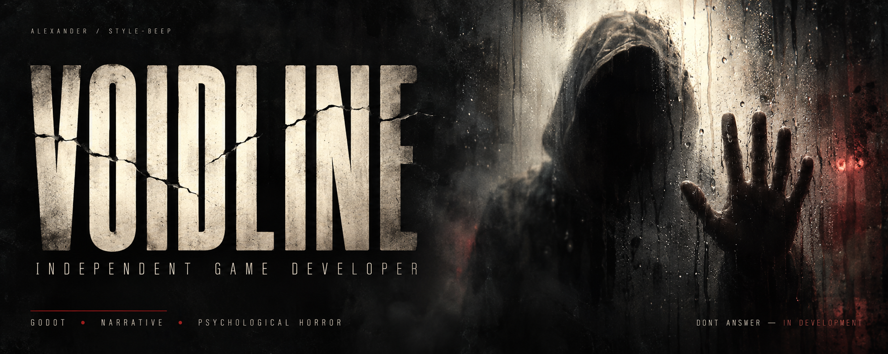
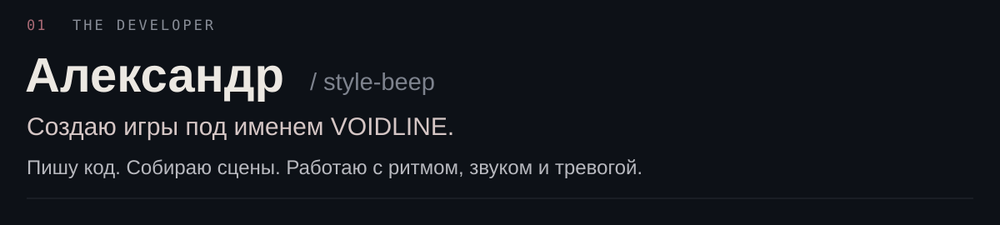
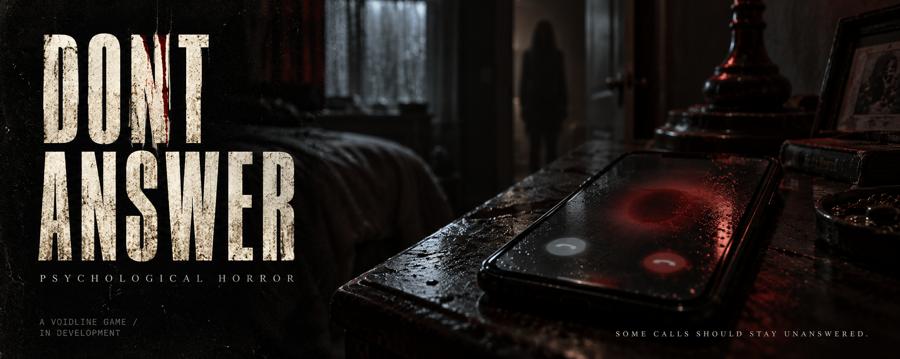
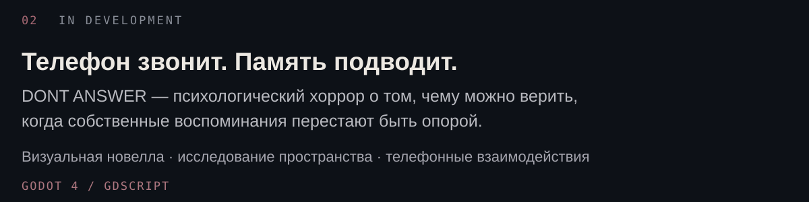
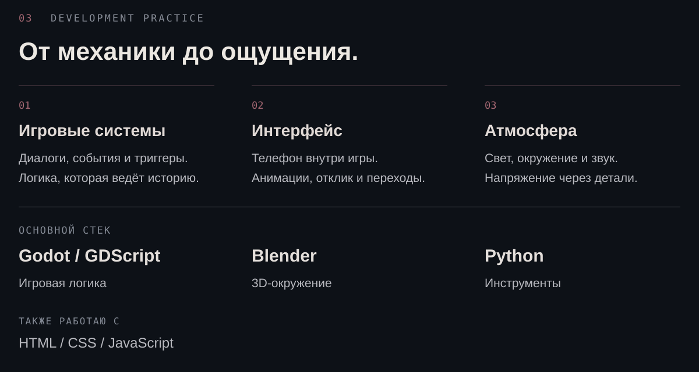

  

  <a href="https://t.me/Donskoyyy"><b>TELEGRAM ↗</b></a>&nbsp;&nbsp; / &nbsp;&nbsp;<a href="mailto:st3614580@gmail.com"><b>EMAIL ↗</b></a>

Текстовая версия / About

**Александр / style-beep** — разрабатываю игры под именем VOIDLINE.

**DONT ANSWER** — психологический хоррор с элементами визуальной новеллы, исследованием пространства и телефонными взаимодействиями. Игра в разработке на Godot 4 / GDScript.

Работаю с сюжетными событиями, интерфейсами и атмосферой. Использую Godot, GDScript, Blender и Python; также занимаюсь веб-проектами на HTML, CSS и JavaScript.

[Telegram](https://t.me/Donskoyyy) · [Email](mailto:st3614580@gmail.com)

VOIDLINE DEVELOPMENT · GAMES / CODE / ATMOSPHERE

